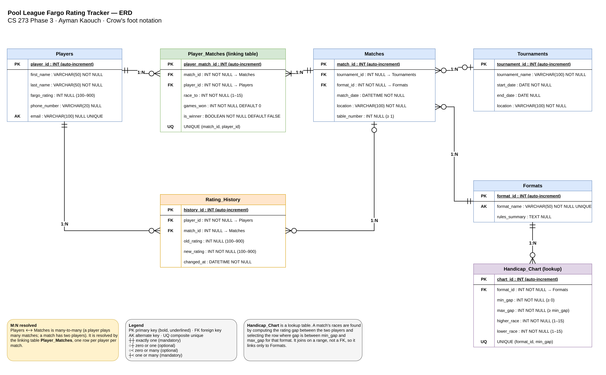

# Phase 3 — ERD Design Narrative

**Project:** Pool League Fargo Rating Tracker
**Student:** Ayman Kaouch · CS 273 Database Systems · Fall 2026

The draw.io source is [`erd.drawio`](erd.drawio) (open it at [app.diagrams.net](https://app.diagrams.net)). `diagram.drawio` is the same file under the name the Phase 3 assignment used. It uses crow's foot notation and shows all 7 tables, every primary and foreign key, the type of every relationship, and the participation (mandatory / optional) on both ends.

---

## 1. What each table represents

| Table | Real-world concept |
| :--- | :--- |
| **Players** | A person registered in the league: name, contact info, and their *current* Fargo Rating (the number that measures skill). |
| **Formats** | A game type the league plays, such as 8-Ball, 9-Ball or 10-Ball, with a summary of its rules. |
| **Tournaments** | A tournament event (name, dates, venue) that groups a set of matches. |
| **Matches** | One scheduled match: when and where it is played, the table number, the format, and the tournament it belongs to (if any). |
| **Player_Matches** | One player's result in one match: the race they had to reach (their handicap), the games they won, and whether they won. A normal match has two rows. This is the linking table for Players ⟷ Matches. |
| **Handicap_Chart** | The league's handicap chart. For each format and each range of rating gaps, it says how many games the higher-rated and the lower-rated player must win. |
| **Rating_History** | A log entry every time a player's Fargo Rating changes, with the old and new rating and the match that caused it. |

---

## 2. Relationships and why each has its type

### Players ⟷ Matches — **M:N**, resolved by `Player_Matches`
A player plays many matches over a season, and every match has more than one player (two in a normal match). Neither table can hold a single FK to the other, so this is many-to-many, which a relational database cannot store directly. It is split into two 1:N relationships through **Player_Matches**.
**If modeled differently:** a `player_id` in Matches would allow only one player per match, and a `match_id` in Players would let a player play only one match ever.

### Players → Player_Matches — **1:N** (Players mandatory one · Player_Matches optional many)
Each Player_Matches row is about exactly one player (`player_id` NOT NULL), but one player has many match rows. A player can have zero rows if they just signed up.
**If modeled differently:** as 1:1, a player could only ever record one match. If Player_Matches were mandatory, a new player could not be added until they had already played.

### Matches → Player_Matches — **1:N** (Matches mandatory one · Player_Matches mandatory many)
Each row belongs to exactly one match (`match_id` NOT NULL), and one match has several player rows (two in practice). A match without players makes no sense, so both sides are mandatory.
**If modeled differently:** as 1:1, a match could store only one player's score, so the opponent's race and result would have nowhere to go. `UNIQUE (match_id, player_id)` stops the same player being entered twice in one match.

### Formats → Matches — **1:N** (Formats mandatory one · Matches optional many)
A format like 9-Ball is used by many matches, but one match is played under exactly one format (`format_id` NOT NULL). A format can exist before anyone plays it.
**If modeled differently:** as M:N, one match could be "8-Ball and 9-Ball at once", which makes the race and handicap meaningless. Storing the format as free text in Matches would let typos like "9 ball" vs "9-Ball" split the statistics.

### Tournaments → Matches — **1:N** (Tournaments optional one · Matches optional many)
A tournament contains many matches, but a match belongs to at most one tournament. The FK `tournament_id` is **nullable** because regular weekly league matches are not part of any tournament, and a tournament can be created before its matches are scheduled.
**If modeled differently:** making `tournament_id` NOT NULL would force fake tournaments for every league night. Making it M:N would let one match count in two tournaments, double-counting results.

### Formats → Handicap_Chart — **1:N** (Formats mandatory one · Handicap_Chart optional many)
Each chart row belongs to one format, because races differ between games (a 9-Ball race is not the same as an 8-Ball race). One format has many rows, one per rating-gap range.
**If modeled differently:** without the `format_id` FK there could only be one chart for every game type. `UNIQUE (format_id, min_gap)` stops two overlapping rows from giving two different races for the same gap.
Handicap_Chart is not linked to Matches or Players by a FK. It is a **lookup table**: the app computes the gap between the two players' ratings and selects the row where the gap falls between `min_gap` and `max_gap`. That race is then saved into `Player_Matches.race_to`, so changing the chart later does not rewrite old matches.

### Players → Rating_History — **1:N** (Players mandatory one · Rating_History optional many)
A player's rating changes many times, and each change is about one player (`player_id` NOT NULL). A new player has no history yet.
**If modeled differently:** storing only `Players.fargo_rating` (as in Phase 2) overwrites the old value after every match, so growth over time is lost. As 1:1, only one change could ever be stored.

### Matches → Rating_History — **1:N** (Matches optional one · Rating_History optional many)
A completed match causes rating changes for both players, so one match can have several history rows. The FK `match_id` is **nullable** because a director can also adjust a rating manually (for example, a player's first established rating), with no match involved.
**If modeled differently:** making `match_id` NOT NULL would block manual adjustments. Leaving out the FK entirely would make it impossible to tell which match caused a rating to rise or fall.

---

## 3. Hardest relationship to figure out

The hardest one was **how players connect to matches**. Because a pool match is usually two people, the obvious idea is to give Matches two columns, `player1_id` and `player2_id`. That causes problems:

- Each player has their *own* race and games won, so the table would need `player1_race`, `player2_race`, `player1_games_won`, and so on, which is a repeating group.
- Finding all matches for one player would need `WHERE player1_id = 7 OR player2_id = 7` in every query.

I resolved it by treating it as a true **M:N** relationship and moving everything that belongs to *one player in one match* into the linking table **Player_Matches**. A player's full history is now one simple join, and the composite unique key `(match_id, player_id)` prevents duplicates.

A close second was the **handicap**. Phase 2 had a `handicap_at_match` number from 0 to 1000, but in Fargo leagues the handicap *is* the race to a number of games. It became `race_to` in Player_Matches, with the rules stored separately in the Handicap_Chart lookup table.

---

## 4. Changes from the Phase 2 field list

1. **Named every table** (Players, Formats, Matches, Player_Matches) and added `VARCHAR` lengths so the ERD is ready for SQL in Phase 4.
2. **Added three tables** my mission statement already promised but the field list did not have: **Tournaments**, **Handicap_Chart** and **Rating_History**. Drawing the ERD made it obvious that objectives like "manage tournament parameters," "handicap lookup thresholds" and "log pre-match and post-match rating updates" had no tables behind them.
3. **Added `tournament_id` (nullable FK) to Matches** to connect matches to tournaments, and **`table_number`** to cover the "table assignments" objective.
4. **Replaced `handicap_at_match` (0–1000) with `race_to` (1–15)**, as explained above.
5. **Removed `games_lost`** from Player_Matches. It always equals the opponent's `games_won`, so storing it twice could make the two values disagree.
6. **Added `UNIQUE (match_id, player_id)`** to Player_Matches so a player cannot appear twice in one match.
7. **Smaller field fixes:** names now allow spaces, hyphens and apostrophes; phone is no longer a unique key (family members can share one); `match_date` no longer defaults to the current time, because matches are scheduled ahead.

---

## 5. What I would add or change with more time

1. **Enforce exactly two players per match.** Crow's foot can show "one or many" Player_Matches per match, but not "exactly two." I would add a check (a trigger or a rule in the PHP app) that blocks a match from being completed without two Player_Matches rows, and one that makes sure exactly one of them has `is_winner = TRUE`.
2. **A `Venues` table.** `location` is free text in both Matches and Tournaments, so "Joe's Billiards" and "Joes Billiards" would count as two places. A Venues table with a FK from both would fix that and let me store how many tables each venue has.
3. **Teams and Seasons.** Real pool leagues are usually played by teams over a season. That would add Teams, Seasons, and a linking table for Players ⟷ Teams (a player can change teams between seasons), which is another M:N to resolve.
4. **Check that `games_won` never exceeds `race_to`.** This is a cross-column rule that belongs in the Phase 4 schema as a `CHECK` constraint.
